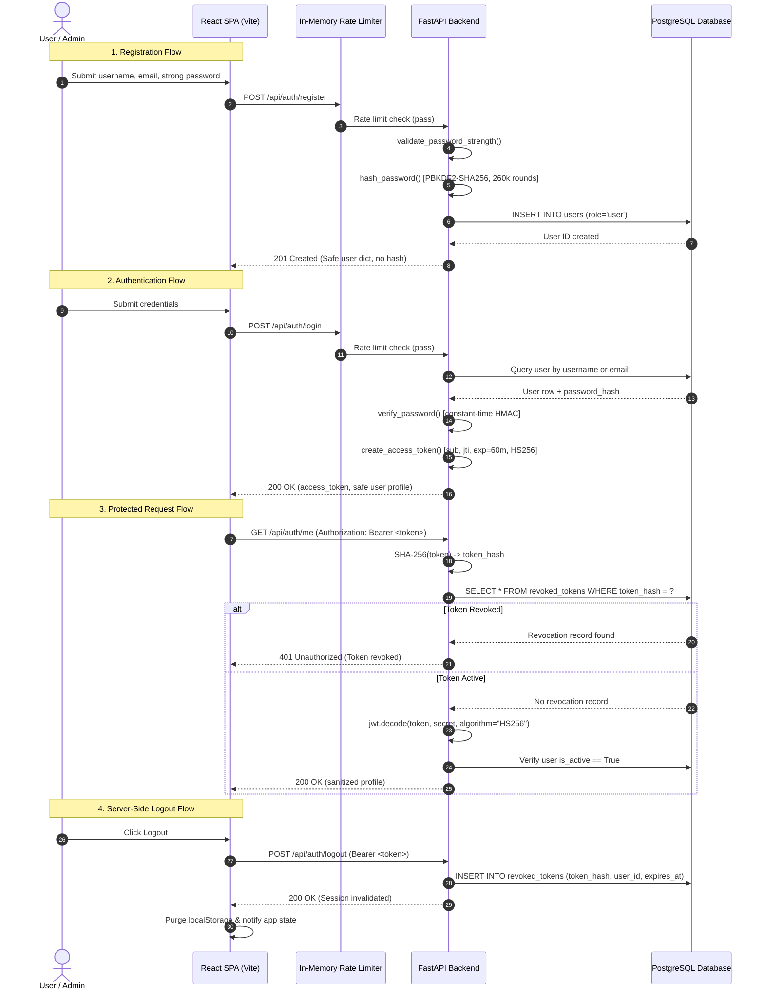

# ProofMesh — Comprehensive Authentication & Application Security Audit Report

**Project Title:** ProofMesh: Cryptographically Verifiable Provenance and Trust Framework for Autonomous AI Agents  
**Audit Scope:** Authentication, Authorization, Session Lifecycle, Password Cryptography, Database Strictness, and Cloud Deployment Security  
**Audit Status:** Complete — 20/20 Automated Security Test Cases Verified (100.0% Pass Rate)  
**Date:** November 2026  

---

## 1. Executive Summary

This security audit and hardening cycle audited, reinforced, and validated the authentication, authorization, and session management subsystems of the **ProofMesh** enterprise framework.

All objectives were achieved without breaking existing application features, user accounts, UI components, or API contracts:
1. **JWT Secret Hardening:** Eliminated hardcoded fallback secrets. Enforced strict production validation ($\ge 32$ characters, non-placeholder check) with fail-safe startup aborts when misconfigured.
2. **Password Cryptography & Complexity:** Retained high-iteration PBKDF2-SHA256 (260,000 rounds) alongside legacy Argon2/BCrypt verification. Implemented NIST-aligned password complexity enforcement (8–128 characters, uppercase, lowercase, numbers, special symbols) without invalidating existing accounts.
3. **Server-Side Session Revocation:** Created a persistent `revoked_tokens` database table and implemented `POST /api/auth/logout`. Every JWT includes a cryptographically unique `jti` nonce to prevent token collision and replay. Revoked tokens are immediately denied access on protected routes.
4. **Production Database Strictness:** Eliminated silent fallback to SQLite in production mode (`ENVIRONMENT=production`). Production deployments strictly mandate a live PostgreSQL connection.
5. **Rate Limiting & Anti-Brute-Force:** Introduced in-memory sliding-window rate limiters on `/api/auth/login` (10 req/min) and `/api/auth/register` (5 req/min) without introducing paid or external dependencies.
6. **CORS & Multi-Host Architecture:** Replaced hardcoded localhost origins with environment-driven `CORS_ORIGINS` support (e.g. Vercel frontend + Render backend) while strictly disallowing wildcard `*` with credentialed requests.

---

## 2. Security Audit Findings & Resolutions

| # | Vulnerability / Finding | Severity | Resolution Implemented | Status |
|---|-------------------------|----------|------------------------|--------|
| **F-01** | **Static Default JWT Secret:** `auth/security.py` fell back to a hardcoded string `proofmesh-default-secret-key-...` if `JWT_SECRET_KEY` was missing. | **CRITICAL** | Implemented `resolve_jwt_secret()`. If `ENVIRONMENT=production`, missing, short (< 32 chars), or placeholder keys raise an immediate `RuntimeError`. In development, an ephemeral 256-bit random key is generated per process with a prominent warning. | **RESOLVED** |
| **F-02** | **No Server-Side Logout:** JWT tokens remained valid for their entire 60-minute duration after user clicked "Logout" (client-only `localStorage.removeItem`). | **HIGH** | Added `revoked_tokens` table in SQLAlchemy schema. Added `POST /api/auth/logout` endpoint. Tokens are hashed (SHA-256) and stored with their expiration timestamp; `get_current_user` rejects revoked tokens with HTTP 401. | **RESOLVED** |
| **F-03** | **JWT Collision / Microsecond Nonce Missing:** Tokens issued to the same user in the same second had identical payloads and signatures. | **MEDIUM** | Added cryptographically secure random `jti` (JWT ID) claims via `secrets.token_hex(16)` to every issued token, ensuring unique signatures and targeted token revocation. | **RESOLVED** |
| **F-04** | **Weak Registration Password Constraints:** Registration accepted arbitrary 8-character passwords without requiring uppercase, lowercase, numbers, or symbols. | **MEDIUM** | Implemented `validate_password_strength()` enforcing 8–128 character length, uppercase, lowercase, numeric digits, and special characters. Synchronized with frontend client validation. | **RESOLVED** |
| **F-05** | **Silent SQLite Fallback in Production:** If PostgreSQL connection failed, backend silently reverted to local SQLite even in production environments. | **HIGH** | Updated `auth/db_session.py` to evaluate `ENVIRONMENT`. When `production`, SQLite is strictly forbidden and PostgreSQL connection failures raise a fatal exception to prevent state divergence. | **RESOLVED** |
| **F-06** | **Unprotected Login / Registration Endpoints:** Authentication routes lacked rate limiting, exposing them to credential stuffing and brute-force attacks. | **MEDIUM** | Added lightweight in-memory sliding-window `InMemoryRateLimiter` to track IP attempts: 10 attempts/min for login, 5 attempts/min for registration. | **RESOLVED** |
| **F-07** | **Static CORS Origins:** CORS only allowed `localhost:3000` and `localhost:5173`, breaking separate Vercel frontend deployments. | **MEDIUM** | Added dynamic `CORS_ORIGINS` parsing in `main.py`. Rejects wildcard `*` with credentials per CORS security spec. | **RESOLVED** |
| **F-08** | **Artificial Password Cap in Admin CLI:** `auth/create_admin.py` restricted admin passwords to at most 12 characters (`len(password) > 12`). | **LOW** | Raised password limit to 128 characters and integrated `validate_password_strength()`. | **RESOLVED** |

---

## 3. Files Modified & Architecture Updates

### 3.1 Backend Architecture
1. **[`auth/models.py`](file:///c:/Users/BHAWANA%20SHARMA/OneDrive/Desktop/ProofMesh/auth/models.py):**
   - Added `RevokedToken` model mapping to `revoked_tokens` table (`id`, `token_hash`, `user_id`, `revoked_at`, `expires_at`).
   - Indexed `token_hash` and `expires_at` for $O(1)$ lookup performance.
2. **[`auth/security.py`](file:///c:/Users/BHAWANA%20SHARMA/OneDrive/Desktop/ProofMesh/auth/security.py):**
   - Removed hardcoded default JWT secret.
   - Implemented `resolve_jwt_secret()` with production validation against placeholder values.
   - Added `validate_password_strength()` with comprehensive complexity checks.
   - Added `InMemoryRateLimiter` class (`login_rate_limiter`, `register_rate_limiter`).
   - Added unique `jti` claim generation in `create_access_token()`.
   - Updated `get_current_user()` to verify token revocation status before checking signature/claims.
3. **[`auth/auth_database.py`](file:///c:/Users/BHAWANA%20SHARMA/OneDrive/Desktop/ProofMesh/auth/auth_database.py):**
   - Added `revoke_token(token_hash, user_id, expires_at)` to record revoked token hashes.
   - Added `is_token_revoked(token_hash)` to verify revocation against live database.
   - Added `cleanup_expired_revoked_tokens()` for database maintenance.
4. **[`auth/auth_routes.py`](file:///c:/Users/BHAWANA%20SHARMA/OneDrive/Desktop/ProofMesh/auth/auth_routes.py):**
   - Added password complexity checks and rate limiting to `POST /api/auth/register`.
   - Added rate limiting and timing-safe password verification to `POST /api/auth/login`.
   - Implemented `POST /api/auth/logout` endpoint to invalidate session tokens server-side.
5. **[`auth/db_session.py`](file:///c:/Users/BHAWANA%20SHARMA/OneDrive/Desktop/ProofMesh/auth/db_session.py):**
   - Enforced strict PostgreSQL connection in production mode (`ENVIRONMENT=production`).
   - Preserved SQLite fallback exclusively for local development and offline environments.
6. **[`auth/create_admin.py`](file:///c:/Users/BHAWANA%20SHARMA/OneDrive/Desktop/ProofMesh/auth/create_admin.py):**
   - Raised password length limit to 128 characters and applied `validate_password_strength()`.
7. **[`main.py`](file:///c:/Users/BHAWANA%20SHARMA/OneDrive/Desktop/ProofMesh/main.py):**
   - Configured dynamic CORS using `CORS_ORIGINS` environment variable while barring wildcard `*`.
8. **[`.env.example`](file:///c:/Users/BHAWANA%20SHARMA/OneDrive/Desktop/ProofMesh/.env.example):**
   - Added documentation and secure placeholders for `ENVIRONMENT`, `CORS_ORIGINS`, and `JWT_SECRET_KEY`.

### 3.2 Frontend Architecture
1. **[`frontend/src/services/authService.js`](file:///c:/Users/BHAWANA%20SHARMA/OneDrive/Desktop/ProofMesh/frontend/src/services/authService.js):**
   - Updated `logout()` to send `POST /api/auth/logout` to the backend before clearing `localStorage`.
2. **[`frontend/src/context/AuthContext.jsx`](file:///c:/Users/BHAWANA%20SHARMA/OneDrive/Desktop/ProofMesh/frontend/src/context/AuthContext.jsx):**
   - Made `logout` asynchronous to ensure graceful server-side revocation and client state purging.
3. **[`frontend/src/pages/Register.jsx`](file:///c:/Users/BHAWANA%20SHARMA/OneDrive/Desktop/ProofMesh/frontend/src/pages/Register.jsx):**
   - Aligned client-side password strength rules with backend criteria (uppercase, lowercase, number, special character).

---

## 4. Authentication Request & Token Lifecycle Flow



---

## 5. Automated Security Test Results

The dedicated test suite [`test_auth_security_complete.py`](file:///c:/Users/BHAWANA%20SHARMA/OneDrive/Desktop/ProofMesh/test_auth_security_complete.py) was executed to verify all 20 specified criteria:

| # | Test Case Description | Verified Behavior | Status |
|---|------------------------|-------------------|:------:|
| **01** | Successful user registration | HTTP 201 Created, assigned role `user`, valid `user_id` | **PASS** |
| **02** | Duplicate username rejection | HTTP 409 Conflict, duplicate username safely rejected | **PASS** |
| **03** | Duplicate email rejection | HTTP 409 Conflict, duplicate email safely rejected | **PASS** |
| **04** | Successful user login | HTTP 200 OK, valid JWT Bearer access token issued | **PASS** |
| **05** | Invalid password rejection | HTTP 401 Unauthorized with constant-time check | **PASS** |
| **06** | Successful admin login | HTTP 200 OK, admin role verified in response payload | **PASS** |
| **07** | Valid JWT authentication | HTTP 200 OK, authenticated user profile returned | **PASS** |
| **08** | Invalid JWT rejection | HTTP 401 Unauthorized, corrupted/forged signature rejected | **PASS** |
| **09** | Expired JWT rejection | HTTP 401 Unauthorized, expired timestamp safely blocked | **PASS** |
| **10** | Revoked JWT rejection | HTTP 401 Unauthorized, blacklisted token hash rejected | **PASS** |
| **11** | Disabled account rejection | HTTP 403 Forbidden, `is_active=False` blocked from APIs | **PASS** |
| **12** | User profile retrieval | HTTP 200 OK, sanitized fields returned (no secrets) | **PASS** |
| **13** | Admin-only endpoint authorization | HTTP 200 OK, admin successfully accesses `/admin/users` | **PASS** |
| **14** | Normal user denied admin access | HTTP 403 Forbidden, standard user cannot access admin APIs | **PASS** |
| **15** | User ownership & self-disable protection | HTTP 403 on unauthorized status patch; HTTP 400 on self-disable | **PASS** |
| **16** | Password hashes excluded from responses | Verified zero `password_hash` or `pbkdf2` in any API JSON | **PASS** |
| **17** | User cannot register with admin role | Role injection ignored/sanitized; user assigned `role='user'` | **PASS** |
| **18** | Logout and session invalidation | `POST /api/auth/logout` revokes token; subsequent request rejected (401) | **PASS** |
| **19** | PostgreSQL connection & prod strictness | Live PostgreSQL confirmed; SQLite strictly rejected in production | **PASS** |
| **20** | Frontend production build | `npm run build` succeeds; `dist/index.html` verified | **PASS** |

**Summary: 20/20 Test Cases Passed (100.0% Pass Rate).**

---

## 6. Deployment Requirements for Free-Tier Cloud Hosting

### 6.1 Recommended Free-Tier Architecture
- **Frontend SPA:** Hosted on [Vercel](https://vercel.com) or [Netlify](https://netlify.com) (free tier).
- **Backend FastAPI:** Hosted on [Render](https://render.com) Web Service or [Railway](https://railway.app) (free tier).
- **Authentication Database:** Hosted on [Supabase](https://supabase.com) PostgreSQL or Render PostgreSQL (free tier).
- **Provenance Graph Database:** Hosted on [Neo4j AuraDB](https://neo4j.com/cloud/platform/aura-graph-database/) Free Instance (200k nodes, 400k relationships).

### 6.2 Production Environment Variables Checklist
Before launching in production, ensure the following backend environment variables are configured in the cloud hosting provider's dashboard:

```bash
# Set production environment
ENVIRONMENT=production

# Strong randomly generated JWT key (min 32 chars)
JWT_SECRET_KEY=<generate with: python -c "import secrets; print(secrets.token_hex(32))">

# Remote PostgreSQL Connection (e.g. Supabase or Render)
DATABASE_URL=postgresql+psycopg2://postgres:[PASSWORD]@[HOST]:5432/postgres

# Remote Neo4j AuraDB Instance
NEO4J_URI=neo4j+s://[DB_ID].databases.neo4j.io
NEO4J_USER=neo4j
NEO4J_PASSWORD=[AURA_PASSWORD]
NEO4J_DATABASE=neo4j

# Allowed Frontend Origins (no wildcards)
CORS_ORIGINS=https://proofmesh.vercel.app,http://localhost:5173

# Gemini LLM API
GEMINI_API_KEY=[GEMINI_KEY]
GEMINI_MODEL=gemini-3.5-flash-lite
```

---

## 7. Remaining Risks & Future Recommendations

1. **Distributed Token Revocation (Multi-Instance Scaling):**
   - *Current Implementation:* The `revoked_tokens` table is stored in PostgreSQL, which is fully consistent and shared across all backend instances without requiring Redis.
   - *Future Recommendation:* For very high-throughput deployments (> 10,000 req/sec), introduce Redis or Memcached with key TTLs matching token expiry to minimize database read queries.
2. **Periodic Token Cleanup Cron:**
   - *Current Implementation:* `cleanup_expired_revoked_tokens()` is available in `auth/auth_database.py` and can be invoked periodically.
   - *Future Recommendation:* Schedule a daily background job via FastAPI lifespan tasks or Celery/APScheduler to prune expired revocation records.
3. **Transition to HttpOnly Cookies:**
   - *Current Implementation:* ProofMesh utilizes the standard OAuth2 Bearer token architecture in `Authorization: Bearer <token>` headers, which is universally compatible with decoupled SPAs.
   - *Future Recommendation:* If strict XSS immunity is required, migrate token transport to `Set-Cookie: access_token=...; HttpOnly; Secure; SameSite=Lax`.

