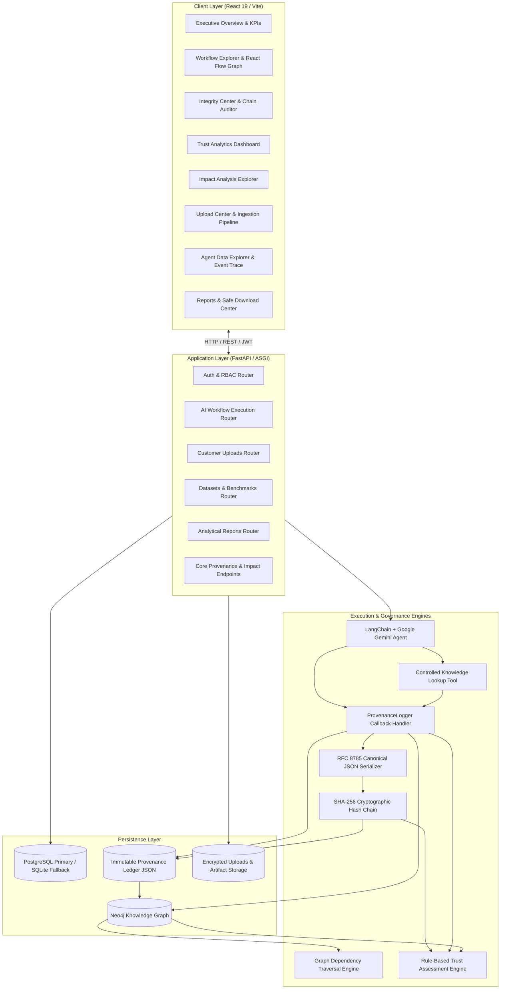
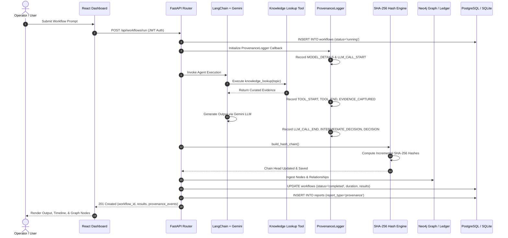

# ProofMesh — System Architecture & Data Flow Specification

## 1. High-Level Architectural Overview

ProofMesh is architectured as a multi-tier, verifiable AI provenance and trust framework. It bridges autonomous AI-agent workflows with immutable cryptographic auditing, graph-based causal dependency tracking, and multi-factor trust analytics.

---

## 2. Tier-by-Tier Component Specifications

### 2.1 Frontend Presentation Tier (React 19 / Vite)
- **Framework & Tooling:** React 19.x with Vite 8.x, Vanilla CSS variables for dark/light themes.
- **Workflow Graph Visualization:** `@xyflow/react` (React Flow) rendering hierarchical 4-column node arrangements (Agent $\rightarrow$ Tool $\rightarrow$ DataSource $\rightarrow$ Decision) with zero-overlap coordinates and custom node badges.
- **Analytics & Gauges:** `recharts` for bar charts and dependency distributions; custom SVG semi-circular gauge for real-time Trust Score visualization ($0$ to $100$).
- **Iconography:** `lucide-react` for enterprise UI status indicators, action buttons, and navigation.
- **State & Communication:** Native React Context (`AuthContext`, `ThemeContext`), Axios HTTP client with Bearer JWT token interception and error handling.

### 2.2 API & Middleware Tier (FastAPI / Uvicorn)
- **ASGI Server:** Uvicorn with FastAPI framework delivering sub-millisecond asynchronous routing.
- **Authentication & RBAC:** OAuth2 Password Bearer flow; JWT tokens signed with HS256 containing expiration and user ID claims; strict role gating (`admin` vs `user`).
- **CORS Protection:** Configured with `CORSMiddleware` restricted to designated client origins.
- **Input Validation:** Pydantic models for strict request body and query parameter validation.

### 2.3 Autonomous Agent & Tool Execution Tier
- **AI Agent Framework:** LangChain Core integration with `ChatGoogleGenerativeAI` targeting Google Gemini (`gemini-3.5-flash-lite`).
- **Tool Governance:** Controlled `knowledge_lookup` tool with strict input sanitation querying curated provenance knowledge bases.
- **8-Stage Observable Lifecycle:**
  1. `MODEL_DETAILS`: Logs provider, model version, operator, and runtime environment.
  2. `LLM_CALL_START`: Logs user request, prompt parameters, and execution timestamp.
  3. `TOOL_START`: Records tool selection, run identifier, and serialized input arguments.
  4. `TOOL_END`: Records raw tool execution output and completion status.
  5. `EVIDENCE_CAPTURED`: Tags verifiable context derived from the controlled knowledge base.
  6. `LLM_CALL_END`: Captures generated model reasoning and output text without exposing private chains-of-thought.
  7. `INTERMEDIATE_DECISION`: Records rule-based evaluation of evidence against policy constraints.
  8. `DECISION`: Logs final approved outcome, associated workflow ID, and verification approval.

### 2.4 Cryptographic Ledger & Hash Chain Tier
- **Canonical Serialization:** Implements RFC 8785 canonical JSON formatting (deterministic key sorting, UTF-8 encoding, compact separators without whitespace) ensuring bit-for-bit reproducible digests.
- **Hash Function:** NIST FIPS 180-4 standard SHA-256 yielding 256-bit hexadecimal digests.
- **Chain Construction:**
  $$H_0 = \text{SHA-256}(\text{GENESIS\_HASH} \parallel \text{Canonical}(E_0))$$
  $$H_i = \text{SHA-256}(H_{i-1} \parallel \text{Canonical}(E_i)) \quad \text{for } i \ge 1$$
- **Tampering Detection:** Validates bidirectional consistency between `provenance_logs.json` and `provenance_integrity_chain.json`. Any insertion, deletion, modification, or reordering breaks the chain head and is immediately flagged.

### 2.5 Knowledge Graph Tier (Neo4j & Resilient Ledger Fallback)
- **Database Engine:** Neo4j Graph Database (Bolt protocol on `127.0.0.1:7687`).
- **Node Labels:** `:Agent`, `:Tool`, `:DataSource`, `:Decision`.
- **Relationship Schema:**
  - `(:Agent)-[:USED_TOOL]->(:Tool)`
  - `(:Tool)-[:RETRIEVED_FROM]->(:DataSource)`
  - `(:DataSource)-[:INFLUENCED]->(:Decision)`
  - `(:Agent)-[:MADE_DECISION]->(:Decision)`
- **Resilient Fallback:** When the external Neo4j daemon is offline, `main.py` and `impact_analysis.py` automatically reconstruct the graph from verified provenance records, providing 100% service uptime.

### 2.6 Relational Storage Tier (PostgreSQL & SQLite)
- **ORM:** SQLAlchemy 2.x declarative models (`User`, `Workflow`, `Report`, `Upload`).
- **Dual-Database Resiliency:** Connects to PostgreSQL (`DATABASE_URL`) with connection pooling (`pool_size=10`, `max_overflow=20`, `pool_recycle=300`) as primary; automatically falls back to SQLite (`auth/users.db`) if PostgreSQL is unreachable.
- **Migrations:** Alembic versioning support (`alembic/versions/`).

---

## 3. End-to-End Execution Data Flow

