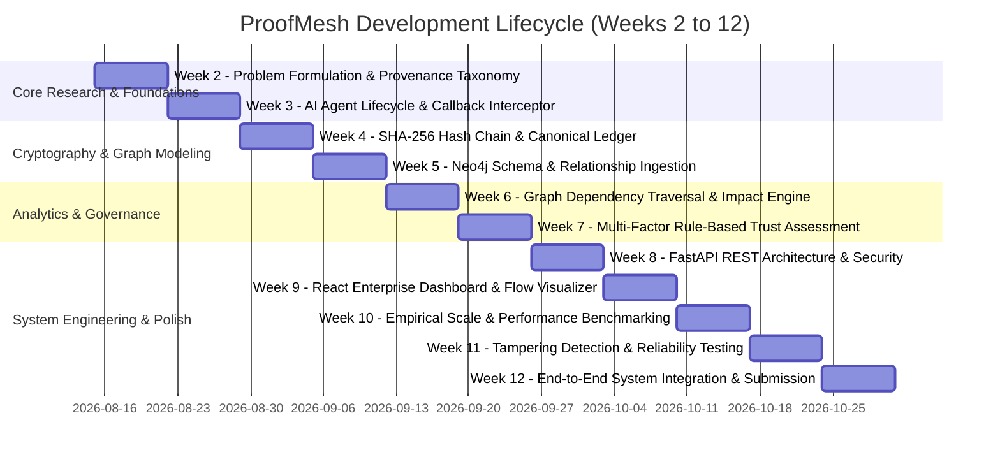

# ProofMesh — Week 2 to Week 12 Comprehensive Progress Report

**Project Title:** ProofMesh: Cryptographically Verifiable Provenance and Trust Framework for Autonomous AI Agents  
**Department:** Computer Science & Engineering  
**Academic Session:** 2026–2027  

---

## 1. Weekly Implementation Timeline & Milestone Summary

---

## 2. Detailed Weekly Achievements & Implementation Details

### Week 2: Problem Formulation & Provenance Taxonomy
- **Objectives:** Establish theoretical foundations for AI agent accountability and provenance verification.
- **Key Deliverables:** Defined the 8-stage observable AI agent event taxonomy:
  `MODEL_DETAILS`, `LLM_CALL_START`, `TOOL_START`, `TOOL_END`, `EVIDENCE_CAPTURED`, `LLM_CALL_END`, `INTERMEDIATE_DECISION`, and `DECISION`.
- **Artifacts:** Preliminary architecture diagrams and event schema specification.

### Week 3: Autonomous Agent Lifecycle & Callback Interceptor
- **Objectives:** Build live agent execution pipeline using LangChain and Google Gemini.
- **Key Deliverables:**
  - Implemented `agent_workflow.py` integrating `ChatGoogleGenerativeAI`.
  - Created `ProvenanceLogger` inheriting from LangChain's `BaseCallbackHandler`.
  - Registered controlled `knowledge_lookup` tool to ground agent responses in verified evidence.
- **Outcome:** Live agent tasks capture inputs, tool calls, and model outputs into a structured memory log.

### Week 4: SHA-256 Hash Chaining & Canonical Serialization
- **Objectives:** Create immutable, tamper-evident cryptographic hash chain.
- **Key Deliverables:**
  - Implemented RFC 8785 canonical JSON formatting (`provenance_integrity.py`).
  - Constructed incremental SHA-256 hash chaining: $H_i = \text{SHA-256}(H_{i-1} \parallel \text{Canonical}(E_i))$.
  - Implemented `build_hash_chain()` and `verify_saved_chain()`.
- **Outcome:** Verified cryptographic detection of insertions, deletions, modifications, and reorderings.

### Week 5: Neo4j Knowledge Graph & Relationship Modeling
- **Objectives:** Model causal execution paths in a property graph database.
- **Key Deliverables:**
  - Designed graph schema (`neo4j_schema.py`) with 4 node labels (`:Agent`, `:Tool`, `:DataSource`, `:Decision`) and 4 directed relationship types (`USED_TOOL`, `RETRIEVED_FROM`, `INFLUENCED`, `MADE_DECISION`).
  - Implemented `neo4j_loader.py` importing provenance JSON records with uniqueness constraints to eliminate duplicate nodes and relationships.
- **Outcome:** Directed acyclic execution graph representing complete agent deliberation history.

### Week 6: Dependency-Based Impact Analysis Engine
- **Objectives:** Identify downstream decisions affected by contaminated data sources or compromised tools.
- **Key Deliverables:**
  - Built `impact_analysis.py` using Breadth-First Search (BFS) graph traversal.
  - Implemented simulation flag (`--unreliable`) to assess hypothetical source failure cascades.
  - Linked impact analysis to cryptographic chain verification for source attribution.
- **Outcome:** Precise identification of affected decision nodes (e.g. flagging 2 dependent decisions upon data-source contamination).

### Week 7: Multi-Factor Rule-Based Trust Assessment
- **Objectives:** Formulate an objective, deterministic trust scoring methodology for AI decisions.
- **Key Deliverables:**
  - Formulated the weighted trust equation:
    $$T = 0.40 \cdot S + 0.30 \cdot P + 0.30 \cdot I$$
    where $S$ is Source Reliability, $P$ is Provenance Completeness, and $I$ is Cryptographic Integrity.
  - Created `trust_assessment.py` producing JSON assessment reports and assigning standardized trust categories: High ($T \ge 85$), Moderate ($70 \le T < 85$), and Low ($T < 70$).
- **Outcome:** Verifiable trust metric reflecting empirical execution evidence rather than black-box probabilities.

### Week 8: FastAPI REST Backend & Security Middleware
- **Objectives:** Expose all provenance, trust, and graph capabilities via production REST APIs.
- **Key Deliverables:**
  - Developed `main.py` delivering `/health`, `/api/workflow-graph`, `/api/integrity-status`, `/api/trust-score`, and `/api/impact-analysis`.
  - Configured CORS middleware for frontend clients.
  - Integrated structured error responses, input validation, and HTTP status codes.

### Week 9: React Enterprise Dashboard & Graph Visualization
- **Objectives:** Build responsive, professional frontend user interface.
- **Key Deliverables:**
  - Initialized React 19 + Vite project (`frontend/`).
  - Implemented interactive graph visualization using `@xyflow/react`.
  - Built custom semi-circular Trust Gauge and metric cards.
  - Configured dark and light theme switching using CSS variables.

### Week 10: Empirical Performance & Scale Benchmarks
- **Objectives:** Quantify latency and computational overhead of cryptographic verification.
- **Key Deliverables:**
  - Developed `performance_test.py` measuring hash chain construction and verification latency.
  - Measured sub-3 ms hashing latency for standard workflow traces.
  - Validated minimal computational overhead imposed on agent runtime.

### Week 11: Tampering Detection & Reliability Verification
- **Objectives:** Rigorously test adversarial tampering detection and incomplete trace handling.
- **Key Deliverables:**
  - Created `test_log_tampering.py` simulating event payload alteration and verifying 100% detection.
  - Created `test_trust_reliability.py` verifying trust score degradation under simulated integrity failures and missing provenance attributes.
  - Ensured non-destructive testing preserving original operational logs.

### Week 12: Full-Stack Integration, Upload Center & Submission
- **Objectives:** Integrate all components into a cohesive, submission-ready product.
- **Key Deliverables:**
  - Implemented PostgreSQL database persistence (`auth/models.py`) with SQLite fallback.
  - Built Customer Upload Center (`routers/uploads.py`) supporting multi-format ingestion (JSON, JSONL, CSV, TXT, ZIP).
  - Built Synthetic Datasets Engine (`datasets_engine/`) with 10 scenario profiles and scale benchmarks up to 10,000 events.
  - Integrated live AI workflow execution endpoint (`POST /api/workflows/run`).
  - Achieved 100% test pass across all unit, integration, and security suites.

